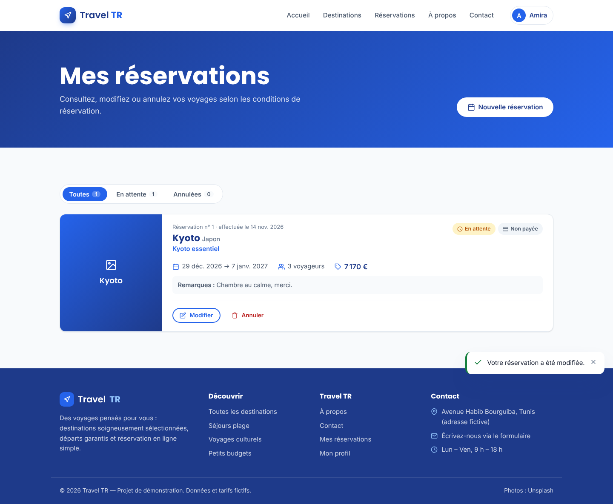

# ✈️ Travel TR

**Travel TR** is a full-stack travel booking web application featuring a destination catalog, search and filters, detailed destination pages, user accounts, and reservation management. The application interface is in French, with a responsive blue, white, and light-blue design for desktop, tablet, and mobile devices.

> **Portfolio demo:** Destinations, prices, dates, and addresses are fictional. No real payments are processed.

### Homepage Preview

| Homepage — View 1 | Homepage — View 2 |
|---|---|
|  |  |

---

## Table of Contents

- [Features](#features)
- [Tech Stack](#tech-stack)
- [Architecture](#architecture)
- [Installation](#installation)
- [Configuration](#configuration)
- [Running the Application](#running-the-application)
- [Testing](#testing)
- [Security](#security)
- [Screenshots](#screenshots)
- [REST API](#rest-api)
- [Credits](#credits)

## Features

| Page | Description |
|---|---|
| **Home** | Hero section with destination, travel type, and budget search; featured destinations, travel categories, budget offers, and benefits |
| **Destinations** | Filterable catalog by **country**, **budget**, and **travel type**; text search; sorting by popularity, price, rating, and name; URL-persisted filters |
| **Destination Details** | Photo gallery, description, highlights, included and optional activities, departure dates, remaining seats, and prices |
| **Booking** | Three-step booking process: destination → departure → travelers, with a summary and total price |
| **My Bookings** | Filterable booking list; edit traveler details and notes; cancel according to booking rules |
| **Sign In / Sign Up** | Client-side and server-side form validation with French error messages |
| **My Profile** | Update name, email address, phone number, and password |
| **About** | Project introduction, values, and how it works |
| **Contact** | Working contact form that stores messages in the database |
| **404 Page** | Custom page for unknown URLs |

**Booking rules** (enforced by the API):

- Bookings are allowed until **3 days** before departure, subject to availability.
- Each user can have only one active booking per departure.
- Bookings can be modified until **7 days** before departure.
- Online cancellations are allowed until **48 hours** before departure; canceled seats become available again.

**Payments:** No payment gateway is integrated. Bookings are marked **“En attente” (Pending)** and **“Non payée” (Unpaid)**; the application does not simulate completed payments.

## Tech Stack

**Frontend**
- [Angular 22](https://angular.dev): standalone components, signals, reactive forms, lazy-loaded routes, route guards, and HTTP interceptor
- SCSS and self-hosted Inter and Poppins fonts (`@fontsource`)
- Unit tests with Vitest (via `ng test`)

**Backend**
- [Node.js](https://nodejs.org) and [Express 5](https://expressjs.com)
- [SQLite](https://sqlite.org) via the built-in `node:sqlite` module (no native compilation; prepared statements)
- [Argon2id](https://github.com/ranisalt/node-argon2) for password hashing
- [Zod](https://zod.dev) for input validation
- `helmet` for security headers and Content Security Policy; `express-rate-limit` for rate limiting
- API tests using `node:test` and `supertest`

**End-to-end testing:** `puppeteer-core` with headless Chrome.

## Architecture

```text
travel-tr/
├── backend/                     # Express REST API
│   ├── src/
│   │   ├── app.js               # Express configuration, security, routes, SPA
│   │   ├── server.js            # Server entry point
│   │   ├── config.js            # Environment configuration
│   │   ├── db/                  # SQL schema, connection, demo data
│   │   ├── middleware/          # Session auth, CSRF, validation, rate limits, errors
│   │   ├── routes/              # auth, users, destinations, reservations, contact
│   │   ├── utils/               # Hashing, tokens, HTTP errors
│   │   └── validation/          # Zod schemas
│   ├── test/                    # API tests
│   └── .env.example
├── frontend/                    # Angular application
│   └── src/app/
│       ├── core/                # Models, services, guards, interceptors, configuration
│       ├── shared/              # Reusable components, validators, directives
│       ├── layout/              # Header and footer
│       └── features/            # Feature-specific pages (.ts / .html / .scss)
├── e2e/                         # End-to-end tests (headless Chrome)
└── docs/                        # Screenshots and security documentation
```

In development, Angular (`ng serve`, port 4200) forwards `/api` requests to the backend (port 3000) using `proxy.conf.json`. In production, the backend also serves the compiled Angular app from the **same origin**, simplifying cookie and CSRF handling.

## Installation

**Requirements:** Node.js **22.22.3+** (22.x) or **24.15.0+** (24.x), and npm.

```bash
git clone https://github.com/ranimedogaz1234-dot/travel-tr.git
cd travel-tr
npm run install:all
```

## Configuration

Copy the example environment file into `backend/.env`.

**Windows CMD:**

```cmd
copy backend\.env.example backend\.env
```

**macOS / Linux:**

```bash
cp backend/.env.example backend/.env
```

| Variable | Purpose | Default |
|---|---|---|
| `NODE_ENV` | `development`, `production`, or `test` | `development` |
| `PORT` | Backend API port | `3000` |
| `DATABASE_PATH` | SQLite database file | `data/travel-tr.sqlite` |
| `CORS_ORIGINS` | Allowed origins if the frontend is hosted separately | Empty = same origin |
| `COOKIE_SECURE` | Restrict cookies to HTTPS | `true` in production |
| `SESSION_TTL_HOURS` | Session lifetime | `168` (7 days) |
| `TRUST_PROXY` | Number of trusted reverse proxies | `0` |

According to the project's configuration documentation, no manually supplied secret key is needed: session tokens are generated randomly, and only their hashes are stored. The SQLite database and demo catalog are created on first startup.

> **Security reminder:** Everything bundled into the Angular frontend is publicly accessible. Never place secrets in frontend code.

## Running the Application

### Development (two terminals)

**Terminal 1 — API:**

```bash
npm run dev:api
```

**Terminal 2 — Angular:**

```bash
npm run dev:web
```

- Frontend: http://localhost:4200
- Backend API: http://localhost:3000

### Production

```bash
npm run build
```

**macOS / Linux:**

```bash
NODE_ENV=production COOKIE_SECURE=true npm start
```

For Windows CMD, set environment variables separately before running `npm start`. For real deployments, use HTTPS with a reverse proxy (such as Nginx or Caddy) and configure `TRUST_PROXY` appropriately.

### Deployment

The app deploys as a single free Render web service using the [`render.yaml`](render.yaml) Blueprint. See [docs/DEPLOYMENT.md](docs/DEPLOYMENT.md) for the hosting limits, environment variables, verification steps, and data-persistence options.

To reset the demo database:

```bash
npm --prefix backend run seed -- --reset
```

## Testing

```bash
npm test
npm run test:e2e
```

The project documentation describes **37 API tests**, **13 Angular unit tests**, and **30 end-to-end scenarios**. End-to-end tests require Chrome (configured through `CHROME_PATH`), a running API on port 3000, and the Angular build.

Scenarios cover navigation, search and filtering, registration, login/logout, booking creation and updates, cancellations, profiles, contact forms, route protection, page refresh, user isolation, and mobile/tablet layouts.

> Test counts and security claims are documented project features, not independently reverified for this README edit.

## Security

Security measures described in the project (see [`docs/SECURITE.md`](docs/SECURITE.md)):

- Password hashing with **Argon2id** instead of plaintext storage
- Server-side sessions using **HttpOnly** cookies, `SameSite=Lax`, and `Secure` in production; SHA-256 hashes of session tokens stored server-side
- **CSRF protection** using `XSRF-TOKEN` and `X-XSRF-TOKEN` with Angular integration
- Login rate limiting (10 attempts per 15 minutes per IP/email), plus registration and contact rate limits
- Server-side authorization restricting reservation access to the owning user
- Zod input validation, parameterized SQL queries, and allowlisted sort fields
- `helmet` security headers and Content Security Policy
- Generic client-facing errors without database errors or stack traces
- The original project documentation reported **0 known vulnerabilities** from `npm audit` at the time of its check

## Screenshots

> The original screenshots were captured in an offline test environment, so some Unsplash photos appear as the application's fallback blue gradient.

### Destinations

| Destinations — View 1 | Destinations — View 2 |
|---|---|
|  |  |

### Destination Details and Login

| Destination Details | Login |
|---|---|
|  |  |

### Bookings

| Booking | My Bookings |
|---|---|
|  |  |

### Mobile


> The three screenshots under `docs/screenshots/` will display only if those image files exist in the repository.

## REST API

All endpoints are prefixed with `/api`. Requests that modify data require the `X-XSRF-TOKEN` header.

| Method | Route | Access | Description |
|---|---|---|---|
| `POST` | `/auth/register` | Public | Register a new account |
| `POST` | `/auth/login` | Public | Log in |
| `POST` | `/auth/logout` | Public | Log out |
| `GET` | `/auth/me` | Public | Current user (or `null`) |
| `GET` / `PUT` | `/users/me` | Authenticated | View or update profile |
| `PUT` | `/users/me/password` | Authenticated | Change password |
| `GET` | `/destinations` | Public | List destinations (`q`, `country`, `type`, `budget`, `sort`) |
| `GET` | `/destinations/filters` | Public | Available filter options |
| `GET` | `/destinations/:slug` | Public | Destination details, activities, departures |
| `GET` | `/reservations` | Authenticated | List my bookings |
| `GET` | `/reservations/rules` | Authenticated | Booking rules |
| `GET` | `/reservations/:id` | Owner | Booking details |
| `POST` | `/reservations` | Authenticated | Create a booking |
| `PATCH` | `/reservations/:id` | Owner | Update a booking |
| `POST` | `/reservations/:id/cancel` | Owner | Cancel a booking |
| `POST` | `/contact` | Public | Submit a contact message |

## Credits

- Photography: [Unsplash](https://unsplash.com) ([Unsplash License](https://unsplash.com/license)), loaded from `images.unsplash.com`
- Icons: inspired by [Feather Icons](https://feathericons.com) (MIT license)
