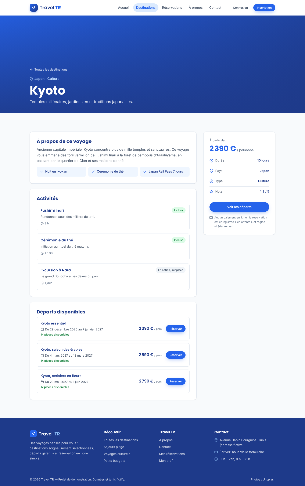
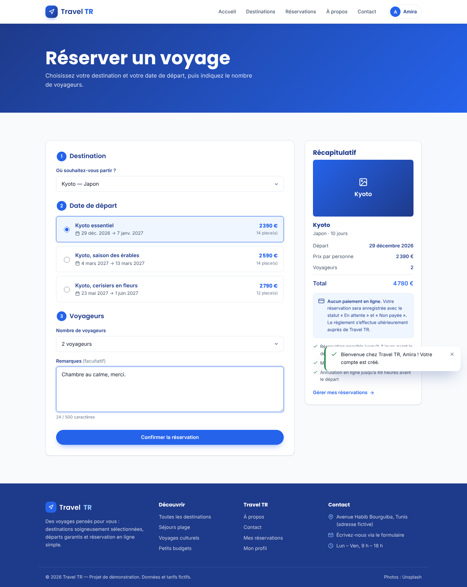
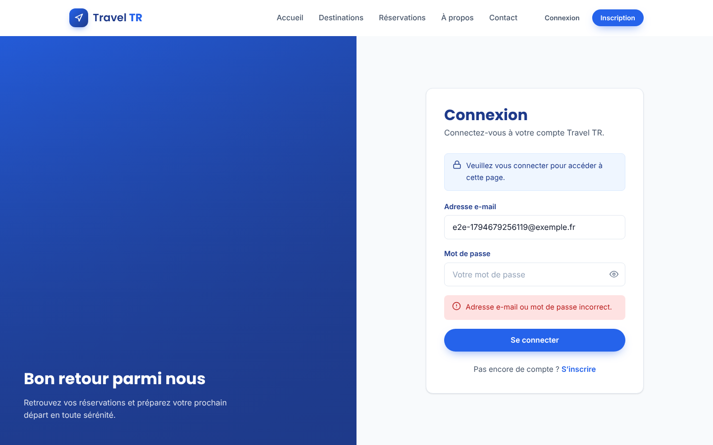

# ✈️ Travel TR

**Travel TR** est une application web complète de réservation de voyages : catalogue de destinations, filtres, pages de détails, comptes utilisateurs sécurisés et gestion des réservations. L’interface est entièrement en français, avec un thème bleu, blanc et bleu clair, et s’adapte aux ordinateurs, tablettes et mobiles.

> Projet de démonstration pour portfolio : les destinations, tarifs, dates et adresses sont **fictifs**. Aucun paiement réel n’est effectué.

![Page d’accueil]


---

## Sommaire

- [Fonctionnalités](#fonctionnalités)
- [Technologies](#technologies)
- [Architecture](#architecture)
- [Installation](#installation)
- [Configuration](#configuration)
- [Lancement](#lancement)
- [Tests](#tests)
- [Sécurité](#sécurité)
- [Captures d’écran](#captures-décran)
- [API REST](#api-rest)

---

## Fonctionnalités

| Page | Description |
|------|-------------|
| **Accueil** | Héros avec recherche (destination, type, budget), destinations à la une, types de voyage, offres à petit prix, avantages |
| **Destinations** | Catalogue filtrable par **pays**, **budget** et **type de voyage**, recherche texte, tri (popularité, prix, note, nom). Les filtres sont conservés dans l’URL |
| **Détails de destination** | Galerie photos, description, points forts, activités (incluses / en option), départs avec places restantes et prix |
| **Réservations** | Réservation en 3 étapes (destination → départ → voyageurs) avec récapitulatif et total |
| **Mes réservations** | Liste filtrable, **modification** (voyageurs, remarques) et **annulation** selon les règles de réservation |
| **Connexion / Inscription** | Formulaires validés côté client et serveur, messages d’erreur en français |
| **Mon profil** | Modification du nom, de l’e-mail et du téléphone, changement de mot de passe |
| **À propos** | Présentation, valeurs, fonctionnement |
| **Contact** | Formulaire fonctionnel : les messages sont enregistrés en base de données |
| **Page 404** | Page personnalisée pour toute URL inconnue |

**Règles de réservation** (appliquées par l’API) :
- réservation possible jusqu’à **3 jours** avant le départ, dans la limite des places disponibles ;
- une seule réservation active par départ et par utilisateur ;
- modification jusqu’à **7 jours** avant le départ ;
- annulation en ligne jusqu’à **48 heures** avant le départ (les places sont libérées).

**Paiement** : aucun module de paiement n’est intégré. Chaque réservation est clairement marquée **« En attente »** et **« Non payée »** ; l’application ne simule jamais un paiement.

## Technologies

**Frontend**
- [Angular 22](https://angular.dev) : composants autonomes, signaux, formulaires réactifs, routes chargées à la demande (*lazy loading*), gardes de route, intercepteur HTTP
- SCSS, polices Inter et Poppins auto-hébergées (`@fontsource`)
- Tests unitaires : Vitest (via `ng test`)

**Backend**
- [Node.js](https://nodejs.org) + [Express 5](https://expressjs.com)
- [SQLite](https://sqlite.org) via le module intégré `node:sqlite` (aucune compilation native, requêtes préparées)
- [Argon2id](https://github.com/ranisalt/node-argon2) pour le hachage des mots de passe
- [Zod](https://zod.dev) pour la validation des entrées
- `helmet` (en-têtes de sécurité, CSP), `express-rate-limit` (anti force brute)
- Tests d’API : `node:test` + `supertest`

**Tests de bout en bout** : `puppeteer-core` avec Chrome headless.

## Architecture

```
travel-tr/
├── backend/                     # API REST Express
│   ├── src/
│   │   ├── app.js               # Configuration Express (sécurité, routes, SPA)
│   │   ├── server.js            # Point d'entrée
│   │   ├── config.js            # Variables d'environnement
│   │   ├── db/                  # Schéma SQL, connexion, données de démonstration
│   │   ├── middleware/          # Auth (sessions), CSRF, validation, limitation, erreurs
│   │   ├── routes/              # auth, users, destinations, reservations, contact
│   │   ├── utils/               # Hachage, jetons, erreurs HTTP
│   │   └── validation/          # Schémas Zod
│   ├── test/                    # Tests d'API
│   └── .env.example
├── frontend/                    # Application Angular
│   └── src/app/
│       ├── core/                # models, services, guards, interceptors, config, utils
│       ├── shared/              # composants réutilisables, validateurs, directives
│       ├── layout/              # en-tête et pied de page
│       └── features/            # une page = un dossier (.ts / .html / .scss)
├── e2e/                         # Tests de bout en bout (Chrome headless)
└── docs/                        # Captures d'écran, rapport de sécurité
```

En développement, Angular (`ng serve`, port 4200) redirige `/api` vers l’API (port 3000) grâce à `proxy.conf.json`. En production, l’API sert aussi l’application Angular compilée : **une seule origine**, ce qui simplifie les cookies et la protection CSRF.

## Installation

**Prérequis** : Node.js **22.22+** (ou 24.15+) et npm.

```bash
git clone https://github.com/<votre-compte>/travel-tr.git
cd travel-tr

# Dépendances de l'API et du frontend
npm run install:all
```

## Configuration

```bash
cp backend/.env.example backend/.env
```

| Variable | Rôle | Valeur par défaut |
|----------|------|-------------------|
| `NODE_ENV` | `development`, `production` ou `test` | `development` |
| `PORT` | Port de l’API | `3000` |
| `DATABASE_PATH` | Fichier SQLite | `data/travel-tr.sqlite` |
| `CORS_ORIGINS` | Origines autorisées (si le frontend est sur un autre domaine) | vide = même origine |
| `COOKIE_SECURE` | Cookies réservés au HTTPS | `true` en production |
| `SESSION_TTL_HOURS` | Durée d’une session | `168` (7 jours) |
| `TRUST_PROXY` | Nombre de proxys inverses de confiance | `0` |

Aucune clé secrète n’est nécessaire : les jetons de session sont générés aléatoirement et seul leur hachage est stocké. La base SQLite et le catalogue de démonstration sont créés automatiquement au premier démarrage.

> ⚠️ Le frontend Angular ne contient **aucun secret** : tout ce qui est compilé dans le navigateur est public.

## Lancement

### Mode développement (deux terminaux)

```bash
npm run dev:api     # API sur http://localhost:3000 (rechargement automatique)
npm run dev:web     # Application sur http://localhost:4200
```

### Mode production (une seule commande)

```bash
npm run build                     # compile Angular dans frontend/dist/
NODE_ENV=production COOKIE_SECURE=true npm start
```

L’application complète est alors servie par l’API sur `http://localhost:3000`. En production, placez-la derrière un proxy HTTPS (Nginx, Caddy…) et définissez `TRUST_PROXY=1`.

Pour réinitialiser la base de démonstration :

```bash
npm --prefix backend run seed -- --reset
```

## Tests

```bash
npm test             # tests d'API (37) + tests unitaires Angular (13)
npm run test:e2e     # 30 scénarios de bout en bout (l'API doit tourner sur le port 3000
                     # avec le build Angular ; Chrome requis, chemin via CHROME_PATH)
```

Les tests de bout en bout couvrent la navigation, la recherche et les filtres, l’inscription, la connexion, la déconnexion, la réservation, la modification, l’annulation, le profil, le contact, la protection des routes, le rafraîchissement de page, l’isolation entre utilisateurs et l’affichage mobile et tablette.

## Sécurité

Résumé des mesures (détails dans [`docs/SECURITE.md`](docs/SECURITE.md)) :

- mots de passe hachés avec **Argon2id** (jamais stockés en clair) ;
- sessions côté serveur dans un cookie **HttpOnly**, `SameSite=Lax`, `Secure` en production ; seul le hachage SHA-256 du jeton est stocké ;
- protection **CSRF** par jeton à double soumission (`XSRF-TOKEN` / `X-XSRF-TOKEN`, géré nativement par Angular) ;
- **limitation des tentatives** de connexion (10 / 15 min par IP et e-mail), d’inscription et de contact ;
- **autorisation côté serveur** : chaque requête de réservation est filtrée par l’utilisateur connecté (pas d’accès aux réservations d’autrui) ;
- validation de toutes les entrées avec Zod, requêtes SQL **paramétrées**, tri par liste blanche ;
- en-têtes `helmet` et **Content Security Policy** stricte ; aucune utilisation de `innerHTML` ni contournement de la sanitisation Angular ;
- erreurs génériques côté client (pas de trace de pile ni d’erreur SQL) ;
- `npm audit` : **0 vulnérabilité** connue au moment de la publication.

## Captures d’écran

> Les captures ont été réalisées dans un environnement de test sans accès à Internet : les photos Unsplash y sont remplacées par le dégradé bleu de repli prévu par l’application. En utilisation normale, les photos s’affichent.

| Destinations | Détails |
|---|---|
| ![Destinations] 


|  |

| Réservation | Mes réservations |
|---|---|
|  |  |

| Connexion | Mobile |
|---|---|
|  |  |

## API REST

Toutes les routes sont préfixées par `/api`. Les requêtes modifiantes exigent l’en-tête `X-XSRF-TOKEN`.

| Méthode | Route | Accès | Description |
|---------|-------|-------|-------------|
| `POST` | `/auth/register` | public | Inscription |
| `POST` | `/auth/login` | public | Connexion |
| `POST` | `/auth/logout` | public | Déconnexion |
| `GET` | `/auth/me` | public | Utilisateur connecté (ou `null`) |
| `GET` / `PUT` | `/users/me` | connecté | Lire / modifier le profil |
| `PUT` | `/users/me/password` | connecté | Changer le mot de passe |
| `GET` | `/destinations` | public | Liste (`q`, `country`, `type`, `budget`, `sort`) |
| `GET` | `/destinations/filters` | public | Options de filtres |
| `GET` | `/destinations/:slug` | public | Détails, activités, départs |
| `GET` | `/reservations` | connecté | Mes réservations |
| `GET` | `/reservations/rules` | connecté | Règles de réservation |
| `GET` | `/reservations/:id` | propriétaire | Détail d’une réservation |
| `POST` | `/reservations` | connecté | Créer une réservation |
| `PATCH` | `/reservations/:id` | propriétaire | Modifier |
| `POST` | `/reservations/:id/cancel` | propriétaire | Annuler |
| `POST` | `/contact` | public | Envoyer un message |

## Crédits

- Photos : [Unsplash](https://unsplash.com) ([licence Unsplash](https://unsplash.com/license)), chargées depuis `images.unsplash.com`.
- Icônes : inspirées du jeu [Feather Icons](https://feathericons.com) (licence MIT).
